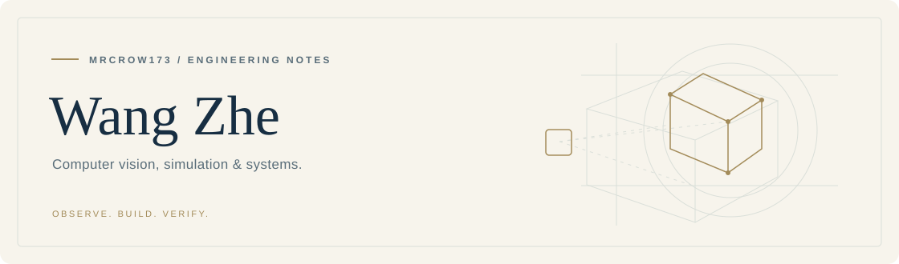
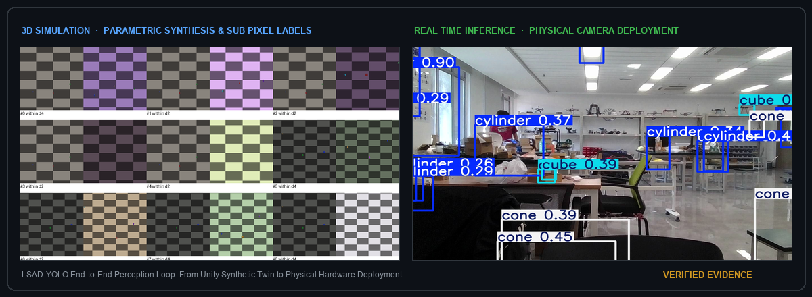

<picture>
  <source media="(prefers-color-scheme: dark)" srcset="https://raw.githubusercontent.com/MRCROW173/MRCROW173/main/assets/profile-header-dark.svg">
  <source media="(prefers-color-scheme: light)" srcset="https://raw.githubusercontent.com/MRCROW173/MRCROW173/main/assets/profile-header-light.svg">
  
</picture>

  <strong>🇺🇸 English</strong> &nbsp;·&nbsp;
  <a href="README_zh.md">🇨🇳 中文版</a>

  <a href="#about">About</a> &nbsp;·&nbsp;
  <a href="#flagship-architectures--milestones">Flagship Systems</a> &nbsp;·&nbsp;
  <a href="#visual-evidence--digital-twin-loop">Visual Evidence</a> &nbsp;·&nbsp;
  <a href="#research--engineering-focus">Research Focus</a> &nbsp;·&nbsp;
  <a href="#technical-matrix">Technical Matrix</a> &nbsp;·&nbsp;
  <a href="#engineering-principles">Principles</a> &nbsp;·&nbsp;
  <a href="mailto:wz13124154500@outlook.com">Contact</a>

---

## About

I'm **Wang Zhe** (known on GitHub as **[MRCROW173](https://github.com/MRCROW173)**). I work at the intersection of **lightweight computer vision architectures, simulation-to-real digital twins, and reliable systems engineering**.

My engineering philosophy centers on closing the full loop: understanding the underlying mathematical mechanism, building clean and performant implementations, rigorously validating against frozen benchmarks, and automating workflows for end-to-end reproducibility.

> **Observe the mechanism. Build the system. Verify the evidence.**

---

## Flagship Architectures & Milestones

| System / Repository | Key Innovations & Architecture | Primary Metrics & Highlights | Status & Access |
| :--- | :--- | ---: | :---: |
| **[LSAD-YOLO](LSAD_YOLO_OVERVIEW.md)** *(Self-developed Detector)* | Shallow detail retention (`PSDR-Down`), smooth-floor annealed localization loss (`AdaInner-CIoU`), Gaussian foreground gating (`GSFMGate`) | Dev mAP@50: **90.41%** Strict Loc $AP_{95}$: **50.53%** Edge GPU Speed: **68+ FPS** | 🚀 Core Mainline [📖 Tech Overview](LSAD_YOLO_OVERVIEW.md) 🔒 Private Research Workspace |
| **[Unity Sim-to-Real Loop](LSAD_YOLO_OVERVIEW.md#4-closed-loop-sim-to-real-digital-twin-pipeline)** *(Digital Twin & Auto-Labeling)* | Closed-loop 3D simulation pipeline: parametric scene randomization, pixel-accurate bounding projection audit, and automated YOLO annotation export | **Zero-Manual** Labeling **Sub-pixel** Projection **964+** Multi-Source Data | 🔄 Production [📖 System Pipeline](LSAD_YOLO_OVERVIEW.md#4-closed-loop-sim-to-real-digital-twin-pipeline) 🔒 Private Research Workspace |

> 📌 **Repository Notice**: Active training execution, raw dataset captures, and checkpoint weights are maintained in a private research workspace (`MRCROW173/Yolo-Unity-Detection-Dystem`) to comply with academic publication and IP requirements. The complete mathematical formulation, paired ablation benchmarks, and verification evidence are openly documented in the **[LSAD-YOLO Technical Overview](LSAD_YOLO_OVERVIEW.md)**.

🇨🇳 <strong>点击展开中文核心成果与自研模型摘要 (Click to expand Chinese Research Summary)</strong>

 

- **自研 LSAD-YOLO 架构**：针对微小目标与复杂遮挡场景，研发浅层细节保留下采样（`PSDR-Down`）与高斯软掩码前景门控（`GSFMGate`），结合平滑软下限定位退火损失（`AdaInner-CIoU`），在维持 68+ FPS 边缘端推理速度的同时，开发集达到 **90.41% mAP@50**，严格定位 **$AP_{95}$ 达 50.53%**（对比基线显著提升 +2.33 pp，且**保持 0 参数膨胀**）。
- **Unity 仿真到实机（Sim-to-Real）数据闭环**：基于 Unity 3D 参数化仿真场景全自动无损生成真值检测框，消除人工标框松弛（1~3 像素系统误差），打通 USB/UVC 真实相机采集与低延迟推理验证全链路。
- 更多中文详情请直接查阅：[🇨🇳 中文完整主页 (README_zh.md)](README_zh.md)。

---

## Visual Evidence & Digital Twin Loop

  

  End-to-end perception loop: from 3D parametric synthesis with sub-pixel annotations in Unity to physical-camera low-latency boundary localization.

---

## Research & Engineering Focus

### 🔬 Object Detection & Loss Dynamics (LSAD-YOLO)
- **Architectural Refinement**: Pioneering detail-preserving shallow downsampling (`PSDR-Down`) and high-resolution bridging to combat feature collapse on micro and occluded targets without explosive computational overhead.
- **Dynamic Loss Formulation**: Developing smooth-floor annealed bounding box regression (`AdaInner-CIoU` & `Alpha-CIoU`), addressing TAL (Task-Aligned Assigner) variance and sub-pixel boundary instability in tight localization tasks.
- **Empirical Rigor**: Enforcing paired baseline controls (plain YOLOv12n / YOLOv8n), frozen evaluation benchmarks, and systematic error taxonomy (classification vs. localization vs. background false positives).

### 🎮 Simulation-to-Real Digital Twin (Unity Loop)
- **Synthetic Data Generation**: Constructing parameterized 3D synthetic scenes in Unity (C#) with automatic camera calibration, multi-angle lighting randomization, and synthetic-to-real domain gap mitigation.
- **End-to-End Inference Services**: Linking real-time camera ingestion (USB/UVC) with low-latency YOLO inference backends, live visual overlays, and automated dataset quality auditing.
- **Domain Independence**: Treating synthetic data iteration and model architectural innovations as decoupled experimental axes to ensure cross-domain generalization.

### ⚡ Embedded Systems & Physical Computing
- **Hardware-Level Control**: Developing low-level firmware on **STM32 microcontrollers** (C/C++), implementing high-precision encoder reading, closed-loop PID motion control, and real-time hardware timers.
- **Systems Thinking**: Connecting low-level software decisions directly to physical actuator behavior, ensuring stability, power efficiency, and timing determinism.

### 🛠️ Developer Infrastructure & Reproducible Workflows
- **Autonomous Tooling**: Building lightweight CLI watchers, Git mirror daemons, and automated validation scripts that run in the background to ensure experimental integrity.
- **Evidence-Driven Records**: Maintaining explicit hash snapshots, provenance receipts, and structured markdown knowledge bases across multi-stage iterations.

---

## Technical Matrix

| Domain | Core Frameworks & Tooling | Engineering Scope & Practice |
| :--- | :--- | :--- |
| **Vision & Deep Learning** | Python 3.11 · PyTorch · Ultralytics · OpenCV · CUDA · TensorRT | Lightweight model architecture, custom loss design, TAL assignment analysis, edge model quantization |
| **Simulation & 3D** | Unity 3D · C# · HLSL Shader Basics · Unity Editor Scripting | Automated camera raster capture, coordinate projection audits, synthetic dataset generation pipelines |
| **Embedded & Systems** | C / C++ · STM32 (HAL / LL) · Keil MDK · PlatformIO | Motor control, optical encoders, PID tuning, UART / I2C / SPI bus protocols, timer interrupts |
| **Software & Foundations** | Java · SQL (MySQL, SQL Server) · Git CI/CD · PowerShell | Relational schema design, asynchronous event dispatchers, background monitoring daemons |

---

## Engineering Principles

- **Start with the evidence.** Read existing codebases, historical benchmark data, and regression records before altering architecture or training hyperparameters.
- **Enforce paired controls.** Every mechanism proposal must run against an identical control baseline under frozen budget, seed, and data protocols.
- **Check actual runtime outputs.** A process exiting with code 0 is only a signal; a verified prediction mask, calibrated bounding box, or hardware response is the true test of success.
- **Design for transparent provenance.** Maintain verifiable hash trails, explicit audit logs, and self-documenting workflows so that all findings can be reproduced independently.

---

## Connect

I welcome technical discussions, academic exchanges, and collaborative exploration in **computer vision research, simulation pipelines, and embedded edge systems**.

  <a href="mailto:wz13124154500@outlook.com"><strong>📧 Email Me</strong> (wz13124154500@outlook.com)</a>
  &nbsp;&nbsp;·&nbsp;&nbsp;
  <a href="https://github.com/MRCROW173?tab=repositories"><strong>📦 Browse Repositories</strong></a>

---

  Observe the mechanism. Build the system. Verify the evidence. · Designed with precision for GitHub Dark & Light themes.

