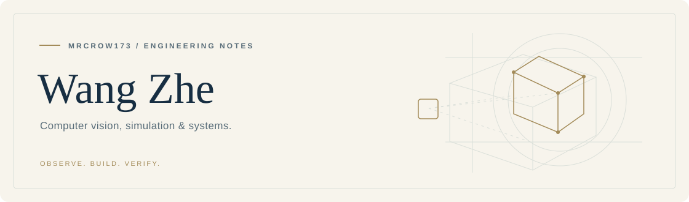
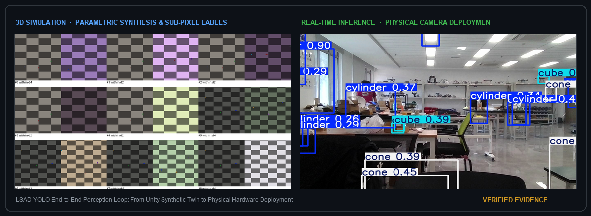

<picture>
  <source media="(prefers-color-scheme: dark)" srcset="https://raw.githubusercontent.com/MRCROW173/MRCROW173/main/assets/profile-header-dark.svg">
  <source media="(prefers-color-scheme: light)" srcset="https://raw.githubusercontent.com/MRCROW173/MRCROW173/main/assets/profile-header-light.svg">
  
</picture>

  <a href="README.md">🇺🇸 English Version</a> &nbsp;·&nbsp;
  <strong>🇨🇳 中文主页</strong>

  <a href="#关于我">关于我</a> &nbsp;·&nbsp;
  <a href="#核心旗舰系统与研究成果">核心旗舰系统</a> &nbsp;·&nbsp;
  <a href="#视觉实证与数字孪生闭环">视觉实证</a> &nbsp;·&nbsp;
  <a href="#研究方向与工程深钻">研究方向</a> &nbsp;·&nbsp;
  <a href="#技术栈矩阵">技术栈矩阵</a> &nbsp;·&nbsp;
  <a href="#工程信条">工程信条</a> &nbsp;·&nbsp;
  <a href="mailto:wz13124154500@outlook.com">联系我</a>

---

## 关于我

我是**王哲**（GitHub: **[MRCROW173](https://github.com/MRCROW173)**）。我的研究与工程方向聚焦于**轻量级边缘计算机视觉架构、仿真到实机（Sim-to-Real）数字孪生数据闭环，以及高可靠系统工程**。

我的研发哲学始终围绕“全流程闭环”展开：深入理解底层的数学机理，构建清晰高效的工程实现，基于严格受控的封存测试集进行实证复验，并通过自动化脚本保障全链路的可复现性。

> **观察机理。构建系统。实证检验。**  
> *(Observe the mechanism. Build the system. Verify the evidence.)*

---

## 核心旗舰系统与研究成果

| 旗舰系统 / 架构方案 | 核心创新机理与技术规范 | 权威基准评测与指标高光 | 运行状态与代码访问 |
| :--- | :--- | ---: | :---: |
| **[LSAD-YOLO](LSAD_YOLO_OVERVIEW.md)** *(自研轻量级目标检测模型)* | 自研浅层细节保留下采样（`PSDR-Down`）、平滑软下限退火边界框定位损失（`AdaInner-CIoU`）、高斯软掩码语义前景门控（`GSFMGate`） | 开发集 mAP@50: **90.41%** 严格定位 $AP_{95}$: **50.53%** 边缘推理速度: **68+ FPS** | 🚀 核心主线 [📖 技术白皮书](LSAD_YOLO_OVERVIEW.md) 🔒 私有科研工程 |
| **[Unity 仿真数据闭环](LSAD_YOLO_OVERVIEW.md#4-closed-loop-sim-to-real-digital-twin-pipeline)** *(数字孪生与全自动标定)* | 闭环三维仿真生成管线：参数化场景随机化、透视投影矩阵无损亚像素 2D 标框导出、实机相机色彩与光照域自适应校准 | **零人工标注成本** **亚像素级**投影贴合 **964+** 多源覆盖数据集 | 🔄 生产运行 [📖 闭环文档](LSAD_YOLO_OVERVIEW.md#4-closed-loop-sim-to-real-digital-twin-pipeline) 🔒 私有科研工程 |

> 📌 **项目访问说明**：受学术论文投稿保密与知识产权规范约束，核心训练代码、原始标注源数据与中间权重托管于私有研发工作区（`MRCROW173/Yolo-Unity-Detection-Dystem`）。完整的数学公式推导、消融实验数据与复现结论已公开汇总于 **[LSAD-YOLO 技术白皮书 (Technical Overview)](LSAD_YOLO_OVERVIEW.md)**。

---

## 视觉实证与数字孪生闭环

  

  从三维仿真数字孪生全自动参数化生成与亚像素标定，到物理真实相机低延迟边界框精细定位的全闭环实证展示。

---

## 研究方向与工程深钻

### 🔬 目标检测架构与损失动态学（LSAD-YOLO）
- **浅层特征保护机制**：针对小目标与严重遮挡场景，研发无参数膨胀的浅层细节保留下采样（`PSDR-Down`）与高分辨率多尺度残差桥，彻底克服浅层特征崩溃问题。
- **定位损失函数创新**：研发自适应内缩辅助回归与平滑软下限余弦退火损失（`AdaInner-CIoU` 与 `Alpha-CIoU`），平抑 TAL（Task-Aligned Assigner）动态标签分配震荡，显著提升高 IoU（$AP_{95}$）严苛定位精度。
- **严苛的配对实验纪律**：强制维持受控基线对照（Plain YOLOv12n / YOLOv8n），严格实行封存测试集隔离与细粒度误差分类归因（分类混淆、定位漂移、背景误检）。

### 🎮 仿真到实机（Sim-to-Real）数字孪生数据闭环
- **高质量合成数据生成**：在 Unity（C#）中构建全参数化三维场景，涵盖动态环境光照随机化、多相机机位姿态采样以及材质反射扰动。
- **全自动亚像素标定引擎**：基于相机投影矩阵直接实时计算无人工介入的真值检测框，从根源消除人工标框松弛（1~3 像素系统误差）。
- **软硬件一体化实时推理工作台**：打通 USB/UVC 真实相机实时图像采集流与 Python YOLO 推理服务，构建低延迟图形化工作台与同图对照复核系统。

### ⚡ 嵌入式底层控制与硬件工程
- **微控制器底层固件**：基于 **STM32（C/C++）** 编写低延迟控制算法，熟练运用硬件定时器、正交编码器高精反馈读取与闭环 PID 电机速度/位置伺服控制。
- **系统工程思维**：将高层算法逻辑与底层物理执行器响应深度关联，追求系统能效比、确定性时间延迟与长期硬件鲁棒性。

### 🛠️ 开发者基建与全自动可复现工作流
- **自治化工程工具**：编写轻量级后台监控守护进程、Git 增量镜像同步引擎与全自动验收测试工具，确保研发全过程具备可审计证据链。
- **透明的证据回溯**：实施严格的哈希快照登记、时序回执存盘与模块化知识库体系，实现实验指标全生命周期可追溯。

---

## 技术栈矩阵

| 领域分类 | 核心框架与工具链 | 工程实践与技术深度 |
| :--- | :--- | :--- |
| **计算机视觉与深度学习** | Python 3.11 · PyTorch · Ultralytics · OpenCV · CUDA · TensorRT | 轻量化模型设计、自定义损失函数构建、TAL 分配动态学分析、边缘端模型推理与量化部署 |
| **三维仿真与数字孪生** | Unity 3D · C# · HLSL 着色器基础 · Unity 编辑器拓展 | 自动化光栅渲染采集、坐标投影矩阵审计、高保真合成数据集全自动流水线 |
| **嵌入式与硬件系统** | C / C++ · STM32 (HAL / LL) · Keil MDK · PlatformIO | 电机伺服控制、光学编码器、数字滤波、PID 算法调谐、UART / I2C / SPI 通信协议 |
| **软件工程与数据架构** | Java · SQL (MySQL, SQL Server) · Git CI/CD · PowerShell | 关系型数据库范式设计、异步事件分发模型、后台轻量级系统守护监测进程 |

---

## 工程信条

- **证据优先（Evidence First）**：动手修改代码或超参数前，必须先查阅历史基准数据、先验文献与失败归因。
- **受控配对对照（Paired Controls）**：任何提出的新机制，必须在相同随机种子、相同训练预算与相同冻结数据下与控制基准严格同台对比。
- **实测输出验收（Ground Truth Outputs）**：命令返回代码 0 仅是信号，模型在真实边界上的定位精度与硬件物理响应才是最终交付事实。
- **透明溯源存证（Traceable Provenance）**：坚持保留版本哈希指纹、原始运行日志与可独立复现的实验记录。

---

## 联系我

非常欢迎在**计算机视觉算法研发、仿真数据闭环系统、嵌入式边缘计算**等方向交流探讨与合作！

  <a href="mailto:wz13124154500@outlook.com"><strong>📧 邮件联系</strong> (wz13124154500@outlook.com)</a>
  &nbsp;&nbsp;·&nbsp;&nbsp;
  <a href="https://github.com/MRCROW173?tab=repositories"><strong>📦 浏览开源仓库</strong></a>

---

  观察机理 · 构建系统 · 实证检验 ｜ 深度适配 GitHub 暗黑与浅色模式

